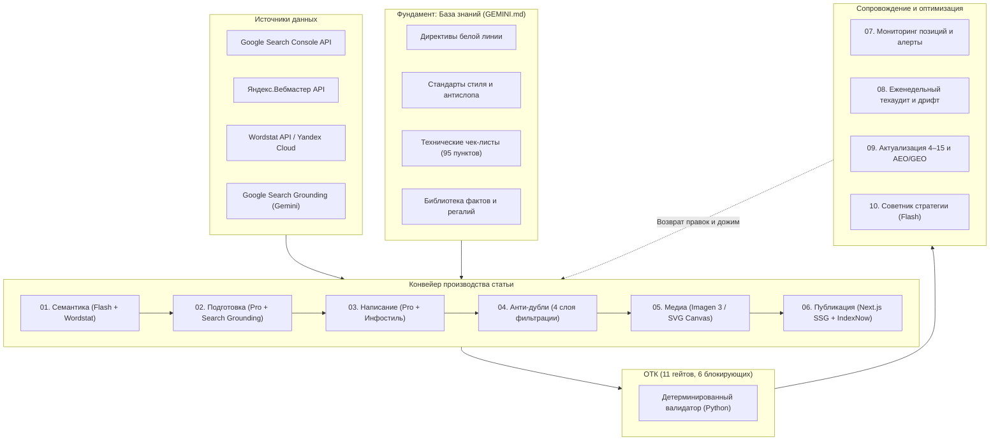

# GEMINI SEO-MACHINE: Полное производственное руководство (105 механик)

> **Статус:** Полная production-архитектура  
> **Ядро:** Экосистема Google Gemini (Gemini 2.5/3.0 Pro, Gemini Flash, Google Search Grounding, Imagen 3, Structured Outputs) + Python 3.11 + Next.js (SSG)  
> **Назначение:** Полный цикл автономного контентного SEO без платных проприетарных подписок и скрытых пейволлов.

---

## 1. Архитектурная карта: 10 систем и 105 механик на Gemini

В отличие от гибридных схем с разрозненными сервисами, данная архитектура опирается на нативные возможности экосистемы Google Gemini:
* **Gemini Pro с Search Grounding:** Исследование живой выдачи в реальном времени, извлечение актуальных фактов и LSI без платных парсеров.
* **Structured Outputs (JSON Schema):** 100% стабильная генерация семантических карт, брифов и JSON-LD микроразметки без галлюцинаций формата.
* **Gemini Flash:** Сверхбыстрая и дешёвая дедупликация, скрипты классификации и ежедневный аудит.
* **Imagen 3:** Генерация фотореалистичных обложек и инфографических диаграмм напрямую через API.



---

## 2. Разбор 10 систем: полная спецификация механик

### Система 00. Фундамент: База знаний и память проекта
1. `GEMINI.md` — индекс архитектуры, расположение директорий, регламенты сборки.
2. `rules/style-guide.md` — 8 правил инфостиля против «нейросетевого слопа».
3. `rules/white-line.md` — директивы поисковой безопасности (что запрещено категорически).
4. `rules/tech-spec.md` — технический регламент на 95 параметров (каноникалы, ЧПУ, коды ответа).
5. `data/fact-library.json` — верифицированные цифры, ГОСТы, нормативные акты с датами годности.
6. `data/author-profiles.json` — профили реальных экспертов со специализацией, опытом и фотографиями.
7. `docs/changelog.md` — автоматический журнал всех правок структуры и кода.
8. `docs/plan.md` — трекер задач сессии для продолжения работы при прерывании контекста.
9. Память сущностей (Entity Graph) — список терминов ниши, зафиксированных за конкретными URL.
10. Стоп-лист стоп-слов и штампов («в современном мире», «ни для кого не секрет»).

### Система 01. Семантика и контент-план
11. Подключение Google Search Console API через service account.
12. Подключение Яндекс.Вебмастер API через OAuth-токен.
13. Интеграция Wordstat API (Yandex Cloud Search API).
14. Парсинг поисковых подсказок Яндекса и Google.
15. Фильтрация брендовых запросов конкурентов.
16. Очистка нецелевого мусора («бесплатно», «своими руками», если услуга платная).
17. Soft-кластеризация по интенту через Gemini Flash с JSON Schema.
18. Выделение главного высокочастотного маркерного запроса.
19. Сбор пула LSI-фраз и хвостов для подзаголовков.
20. Вычисление приоритета тем (коммерческий интент > лид-факторы > частотность).
21. Расчёт сметы перед сбором (бюджет-гейт на токены и API).
22. Автозаморозка выдохшихся сезонных тем.
23. Генерация единого реестра `semantic-map.json`.

### Система 02. Подготовка и конкурентный реверс-инжиниринг
24. Анализ топ-3 выдачи через Gemini Search Grounding.
25. Подсчёт медианной длины статей в символах и словах.
26. Определение необходимого количества изображений (формула: $\text{Медиана} \times 1.15$).
27. Проверка наличия таблиц, калькуляторов и списков у лидеров топа.
28. Карта заголовков H2/H3 победителей.
29. Выявление «контентных дыр» конкурентов (вопросы, оставшиеся без ответа).
30. Формирование «угла отстройки» (уникальное торговое преимущество страницы).
31. Генерация строгого брифа статьи в JSON.
32. Автоматический подбор FAQ из реальных пользовательских вопросов.
33. Предопределенная сетка внутренней перелинковки до написания текста.
34. Кэширование данных выдачи на 45 дней во избежание лишних запросов.

### Система 03. Написание контента (Фабрика текстов)
35. Ролевая изоляция: Промпт-планировщик (структурирует фактуру).
36. Написание статьи моделью Gemini 2.5/3.0 Pro.
37. Антислоп-проход: принудительное устранение пассивного залога и канцелярита.
38. Внедрение конкретики: формулы, расчеты, реальные сценарии.
39. Автономный агент-фактчекер: проверка каждой цифры по `fact-library.json`.
40. Юридический аудит: маркировка дисклеймеров (медицина, финансы, юриспруденция).
41. Контроль плотности списков (не более 20% от общего объема статьи).
42. Форматирование под прямые ответы AEO (Answer Engine Optimization) в первом абзаце.
43. Запрет на использование дешёвых моделей для генерации чистового текста.

### Система 04. Защита от дублей и каннибализации
44. Слой A: Сравнение лемм и корней темы с журналом опубликованного до генерации.
45. Слой B: Проверка конфликта информационного запроса с коммерческими посадочными.
46. Слой C: Лимит на количество статей в одном смысловом кластере (максимум 3–4).
47. Слой D: Попарная проверка семантического сходства всех живых URL раз в неделю.
48. Ведение реестра соответствия `URL ↔ Keywords`.
49. Автоматическое предложение создания контентного хаба при разрастании темы.
50. Выдача готовых директив `rel="canonical"` для склейки конкурирующих страниц.
51. Ведение белого списка исключений для схожих сущностей.

### Система 05. Обложки и медиа-сопровождение
52. Генерация векторных инфографик и диаграмм в HTML/SVG через Headless Chrome (0 ₽).
53. Генерация фотореалистичных обложек через Imagen 3 API с фиксированным сидом стиля.
54. Автоматическое сжатие всех изображений в современный формат `.webp`.
55. Генерация осмысленных атрибутов `alt` на основе LSI-семантики статьи.
56. Врезка контекстных изображений строго после смысловых блоков H2.
57. Генерация категорийных заглушек в единой дизайн-системе при сбое внешних API.
58. Пакетный ночной добор недостающих медиа-ресурсов.
59. Автоматическая простановка атрибутов ширины, высоты и `loading="lazy"`.

### Система 06. Публикация и моментальная индексация
60. Адаптер выгрузки в Markdown/MDX для Next.js (App Router SSG).
61. Адаптер публикации через REST API для WordPress/Headless CMS.
62. Режим безопасного старта: выгрузка в статус `draft` для ручного аппрува первых 10 статей.
63. Автоматическая сборка статических страниц (`npm run build`).
64. Протокол IndexNow: мгновенный пинг серверов Яндекса и Bing при добавлении URL.
65. Автоматическая отправка на переобход через Google Search Console API.
66. Обновление `sitemap.xml` и валидация даты `<lastmod>`.
67. Генерация HTML-карты сайта для перелинковки.
68. Верификация ответа сервера: подтверждение статуса HTTP 200 на опубликованном адресе.
69. Отправка отчёта о публикации в Telegram-канал проекта.

### Система 07. Ежедневный мониторинг и утренний дайджест
70. Автоматический опрос позиций ключей каждое утро в 06:00.
71. Расчёт динамики: дельта позиций ко вчерашнему дню и прошлой неделе.
72. Алерты на вылет из топ-10 и топ-30.
73. Модуль «Быстрые победы»: выделение запросов на позициях 4–15 с высоким показом.
74. Формирование рекомендаций по 1–2 рычагам дожима для каждой быстрой победы.
75. Сводка в Telegram в 08:30: ключевые цифры и 3 приоритета на день человеческим языком.
76. Автономная веб-витрина `Панель.html` (работает локально без серверов).
77. Оценка запаса тем в днях при текущем темпе публикаций.

### Система 08. Еженедельный аудит и контроль дрифта
78. Полный краулинг сайта по карте `sitemap.xml` каждую субботу в 07:00.
79. Проверка битых внутренних и внешних ссылок (статусы 404, 500, циклические редиректы 301).
80. Проверка дублирования тегов `title`, `description` и заголовков `h1`.
81. Аудит микроразметки Schema.org (Article, BreadcrumbList, FAQPage, Organization).
82. Измерение Core Web Vitals (LCP, CLS, FID/INP) через PageSpeed Insights API.
83. Поиск страниц-сирот (orphan pages), на которые нет ни одной входящей ссылки.
84. Построение матрицы внутреннего ссылочного веса (PageRank симуляция).
85. Анализ экспертности E-E-A-T (наличие автора, источников, даты актуализации).
86. Ежедневный контроль дрифта (09:00): сверка прода с эталонным снимком (hash HTML/meta).
87. Мгновенный алерт при случайном закрытии сайта от индексации в `robots.txt`.

### Система 09. Актуализация контента и AEO/GEO-оптимизация
88. Автопоиск статей старше 90–120 дней, теряющих позиции.
89. Смысловой рефреш: добавление актуального абзаца без полного переписывания.
90. Синонимизация метатегов под изменившиеся формулировки спроса.
91. Честное обновление поля `dateModified` в JSON-LD разметке.
92. Оптимизация под Google AI Overviews и Яндекс Нейро: блок с прямым ответом (40–60 слов).
93. Генерация файла `llms.txt` в корне сайта для краулеров искусственного интеллекта.
94. Настройка разрешений в `robots.txt` для GPTBot, Google-Extended, ClaudeBot.

### Система 10. Советник стратегии и финансовый контроль
95. Анализ расходов на API Gemini за неделю (учёт использования токенов).
96. Установка жесткого лимита расходов на прогон (бюджет-стоп).
97. Еженедельный стратегический план: распределение публикаций по кластерам.
98. Чекап здоровья 18 внутренних модулей скрипта.
99. Рекомендации по корректировке темпа выпуска статей в зависимости от трафика.
100. Изоляция советника: советник только генерирует отчеты в Telegram и не имеет прав на запись в прод.

---

## 3. Слой ОТК: 11 обязательных проверок качества (6 блокирующих)

Перед выкладкой статьи любой сгенерированный материал проходит через автоматический скриптовый валидатор `validator.py`:

| № | Название проверки | Статус | Условие блокировки публикации |
|---|---|---|---|
| **1** | **URL & Slug Sanitizer** | **БЛОКИРУЮЩИЙ** | Наличие кириллицы, заглавных букв, спецсимволов или совпадение slug с существующим. |
| **2** | **Duplicate Title Gate** | **БЛОКИРУЮЩИЙ** | Совпадение заголовка более чем на 75% с любой опубликованной статьёй. |
| **3** | **Fact Integrity Gate** | **БЛОКИРУЮЩИЙ** | Наличие неподтвержденных статистических цифр без ссылки на `fact-library.json`. |
| **4** | **Meta Tags Boundary** | **БЛОКИРУЮЩИЙ** | `title` пустой или > 90 симв; `description` пустой или > 260 симв. |
| **5** | **JSON-LD Schema Gate** | **БЛОКИРУЮЩИЙ** | Невалидный синтаксис JSON-LD или отсутствие полей `author`, `datePublished`. |
| **6** | **Self-Canonical Gate** | **БЛОКИРУЮЩИЙ** | Отсутствие тега `<link rel="canonical">` или ссылка на чужой URL. |
| 7 | List Density Guard | Предупреждение | Доля маркированных списков превышает 25% от объема текста. |
| 8 | E-E-A-T Author Card | Предупреждение | Отсутствует привязка к валидному профилю автора в `author-profiles.json`. |
| 9 | Content Length Check | Предупреждение | Длина текста меньше 85% от среднего показателя конкурентов в топе. |
| 10 | Media & Alt Completeness | Предупреждение | В тексте нет ни одного изображения или у картинок отсутствуют теги `alt`. |
| 11 | Internal Link Check | Предупреждение | В теле статьи менее 2 внутренних ссылок на релевантные категории/статьи. |

---

## 4. Комплект производственных промптов под Gemini

Ниже приведены готовые промпты, использующие возможности Gemini (Search Grounding, Structured Outputs, System Instructions).

### Промпт 1: Архитектура сайта и дизайн-система на Next.js 14
```text
Ты — Senior Web Architect и ведущий SEO-инженер. Наша цель — спроектировать быстрый, масштабируемый контентный ресурс на Next.js 14 (App Router, SSG, Tailwind CSS, TypeScript).

Ниша: [УКАЖИТЕ НИШУ]
Целевой регион: [УКАЖИТЕ РЕГИОН]

Сформируй следующие артефакты:
1. Полную структуру каталогов проекта с поддержкой /blog, /blog/[category], /blog/[slug].
2. Конфигурацию Tailwind CSS и CSS-переменных для единой дизайн-системы (шрифты, отступы, контрастные цвета для доступности WCAG AA).
3. Шаблон разметки статьи с обязательными блоками: хлебные крошки, оглавление (Table of Contents), авторский байлайн со стажем, дата публикации и lastmod, блок FAQ, форма целевого действия (CTA), блок «Читайте также».
4. Компонент генерации микроразметки JSON-LD (Schema.org): WebSite, Organization, Article, BreadcrumbList, FAQPage.
5. Правила генерации ЧПУ: только латиница, нижний регистр, дефисы. Кириллица категорически запрещена.
```

### Промпт 2: Исследование ниши и семантическая карта (Search Grounding)
```text
Включи инструмент Google Search Grounding. Проведи глубокое исследование поисковой выдачи по теме: [УКАЖИТЕ КОРНЕВОЙ ЗАПРОС].

Задачи:
1. Собери 10 ключевых кластеров информационного спроса с оценкой потенциала трафика.
2. Изучи топ-3 страницы в выдаче Google по каждому кластеру. Выдели их слабые места: устаревшие данные, отсутствие таблиц, сложный язык, слабая структура.
3. Сформируй итоговый файл 'semantic-map.json' со строгой JSON-схемой:
{
  "clusters": [
    {
      "id": "slug-temy",
      "category": "kategoriya",
      "main_intent": "info",
      "target_query": "главный поисковый запрос",
      "lsi_keywords": ["фраза 1", "фраза 2", "фраза 3"],
      "competitor_urls": ["url1", "url2"],
      "recommended_word_count": 1800,
      "status": "planned"
    }
  ]
}
Исключи любые коммерческие транзакционные запросы со словами "купить", "цена", "доставка".
```

### Промпт 3: Написание эталонной экспертной статьи (Anti-Slop Engine)
```text
Роль: Шеф-редактор инфостиля и профильный эксперт ниши [НИША].
Задача: Написать глубокую, исчерпывающую статью на основе брифа.

Бриф статьи:
- Тема и H1: [ТЕМА]
- Главный запрос: [ЗАПРОС]
- LSI-ключи: [СПИСОК LSI]
- Целевой объём: [ЧИСЛО СИМВОЛОВ]
- Наш фокус (отстройка от топа): [УНИКАЛЬНЫЙ УГОЛ]

Требования к тексту:
1. Интонация и стиль: Инфостиль. Никакой «воды», вводных штампов («не секрет, что», «в современном динамичном мире»), пассивных конструкций. Только факты, конкретные алгоритмы и примеры.
2. Первый экран: В первых 50 словах дай прямой, исчерпывающий ответ на главный вопрос темы (для поисковых ИИ-сниппетов AEO).
3. Структура: Чёткая иерархия H2 и H3. Если сравниваются сущности — обязательно включи структурированную Markdown-таблицу.
4. Доля списков: Списки должны занимать не более 20% объёма. Основа материала — связный, логичный текст с живыми примерами.
5. Завершение: Блок FAQ из 3–4 реальных вопросов и блок практических выводов.
Выведи результат в валидном формате MDX с заполненным frontmatter (title, description, author, date, tags).
```

### Промпт 4: Актуализация статьи в зоне дожима (4–15 позиции)
```text
У нас есть опубликованная статья со слагом: [SLUG].
Текущая позиция в поиске: [ПОЗИЦИЯ ОТ 4 ДО 15].
Основной запрос: [ЗАПРОС].

Изучи текущий топ-3 выдачи Google по этому запросу. Сделай точечный дожим страницы:
1. Сохрани неизменными URL-слаг, базовую структуру H2 и общий смысл.
2. Напиши один новый смысловой блок (100–150 слов) с актуальными данными на 2026 год (новый нюанс, измененный норматив, свежая статистика), который закроет пробел по сравнению с лидером выдачи.
3. Аккуратно скорректируй title и description, усилив кликабельность (CTR) и вплетя недостающий LSI-хвост.
4. Обнови поле 'dateModified' на текущую дату.
Выведи только дифференциальные изменения: какой блок заменить/добавить и новые значения метатегов.
```

---

## 5. Готовый production-код системы (Python 3.11)

### Скрипт 1: Автономный гейт качества `validator.py`
Реализует детерминированную проверку всех 11 критериев ОТК перед допуском к коммиту.

```python
import os
import re
import sys
import json
from pathlib import Path

class ContentQualityGate:
    def __init__(self, blog_dir: str, registry_path: str):
        self.blog_dir = Path(blog_dir)
        self.registry_path = Path(registry_path)
        self.registry = self._load_registry()

    def _load_registry(self) -> dict:
        if self.registry_path.exists():
            with open(self.registry_path, "r", encoding="utf-8") as f:
                return json.load(f)
        return {"published_slugs": [], "titles": []}

    def validate_article(self, file_path: Path) -> tuple[bool, list[str]]:
        errors = []
        warnings = []
        content = file_path.read_text(encoding="utf-8")

        # 1. Проверка slug на кириллицу и спецсимволы
        slug = file_path.stem
        if not re.match(r"^[a-z0-9-]+$", slug):
            errors.append(f"Gate 1 [BLOCKING]: Недопустимый slug '{slug}'. Разрешены только латиница, цифры и дефис.")

        # 2. Проверка дублирования slug в реестре
        if slug in self.registry.get("published_slugs", []) and not os.environ.get("ALLOW_UPDATE"):
            errors.append(f"Gate 1 [BLOCKING]: Slug '{slug}' уже существует в реестре публикаций.")

        # Парсинг frontmatter (YAML/JSON)
        frontmatter_match = re.search(r"^---\s*(.*?)\s*---", content, re.DOTALL)
        if not frontmatter_match:
            errors.append("Gate 5 [BLOCKING]: Отсутствует заголовок Frontmatter.")
            return False, errors

        fm_text = frontmatter_match.group(1)
        
        # 3. Проверка Title и Description
        title_match = re.search(r'title:\s*["\']?(.*?)["\']?$', fm_text, re.MULTILINE)
        desc_match = re.search(r'description:\s*["\']?(.*?)["\']?$', fm_text, re.MULTILINE)

        if not title_match or len(title_match.group(1).strip()) == 0:
            errors.append("Gate 4 [BLOCKING]: Пустой или отсутствующий тег title.")
        else:
            title = title_match.group(1).strip()
            if len(title) > 90:
                warnings.append(f"Gate 4: Длина title ({len(title)}) превышает 90 символов.")
            if title in self.registry.get("titles", []):
                errors.append(f"Gate 2 [BLOCKING]: Полный дубль заголовка '{title}'.")

        if not desc_match or len(desc_match.group(1).strip()) == 0:
            errors.append("Gate 4 [BLOCKING]: Пустой тег description.")
        elif len(desc_match.group(1).strip()) > 260:
            warnings.append(f"Gate 4: Длина description ({len(desc_match.group(1).strip())}) превышает 260 символов.")

        # 4. Проверка плотности списков
        body = content[frontmatter_match.end():]
        total_lines = [l.strip() for l in body.split("\n") if l.strip()]
        list_lines = [l for l in total_lines if l.startswith(("-", "*", "1.", "2.", "3."))]
        if total_lines and (len(list_lines) / len(total_lines)) > 0.30:
            warnings.append("Gate 7: Превышена плотность списков (>30% строк). Разбавьте текст связными абзацами.")

        # 5. Проверка наличия изображений и alt-тегов
        images = re.findall(r"!\[(.*?)\]\((.*?)\)", body)
        if not images:
            warnings.append("Gate 10: В статье отсутствуют изображения.")
        else:
            for alt, src in images:
                if not alt.strip():
                    warnings.append(f"Gate 10: Изображение {src} не имеет атрибута alt.")

        # Итог проверки
        is_valid = len(errors) == 0
        all_messages = errors + warnings
        return is_valid, all_messages

if __name__ == "__main__":
    if len(sys.argv) < 2:
        print("Использование: python validator.py <путь_к_статье.mdx>")
        sys.exit(1)

    target_file = Path(sys.argv[1])
    validator = ContentQualityGate(blog_dir="content/blog", registry_path="seo-agent/registry.json")
    success, reports = validator.validate_article(target_file)

    for msg in reports:
        print(msg)

    if not success:
        print("\n❌ Статья не прошла ОТК. Публикация заблокирована.")
        sys.exit(1)
    else:
        print("\n✅ Статья успешно прошла все блокирующие гейты ОТК.")
        sys.exit(0)
```

### Скрипт 2: Автономная веб-витрина `generate_panel.py`
Генерирует автономную локальную HTML-панель за 1 секунду без внешних зависимостей.

```python
import json
from pathlib import Path
from datetime import datetime

def build_dashboard():
    # Загрузка метрик из реестра
    data_file = Path("seo-agent/panel_data.json")
    if data_file.exists():
        with open(data_file, "r", encoding="utf-8") as f:
            data = json.load(f)
    else:
        data = {
            "verdict": "green",
            "verdict_text": "Конвейер работает штатно",
            "planned_articles": 24,
            "days_reserve": 8.5,
            "traffic_yandex": 3420,
            "traffic_google": 1850,
            "quick_wins_count": 7,
            "last_audit_date": datetime.now().strftime("%Y-%m-%d"),
            "critical_errors": 0
        }

    html_content = f"""<!DOCTYPE html>
<html lang="ru">
<head>
    <meta charset="UTF-8">
    <meta name="viewport" content="width=device-width, initial-scale=1.0">
    <title>SEO Machine Dashboard</title>
    <style>
        :root {{
            --bg: #0f172a;
            --card-bg: #1e293b;
            --text-main: #f8fafc;
            --text-muted: #94a3b8;
            --accent-green: #10b981;
            --accent-yellow: #f59e0b;
            --accent-red: #ef4444;
            --border: #334155;
        }}
        body {{
            margin: 0;
            padding: 24px;
            font-family: -apple-system, BlinkMacSystemFont, "Segoe UI", Roboto, sans-serif;
            background-color: var(--bg);
            color: var(--text-main);
        }}
        .header {{ display: flex; justify-content: space-between; align-items: center; margin-bottom: 24px; }}
        .verdict-badge {{
            padding: 8px 16px;
            border-radius: 9999px;
            font-weight: 700;
            font-size: 14px;
            background: rgba(16, 185, 129, 0.2);
            color: var(--accent-green);
            border: 1px solid var(--accent-green);
        }}
        .grid {{ display: grid; grid-template-columns: repeat(auto-fit, minmax(240px, 1fr)); gap: 16px; }}
        .card {{
            background: var(--card-bg);
            border: 1px solid var(--border);
            border-radius: 12px;
            padding: 20px;
        }}
        .card-title {{ font-size: 13px; color: var(--text-muted); text-transform: uppercase; margin-bottom: 8px; }}
        .card-val {{ font-size: 32px; font-weight: 800; font-family: monospace; }}
        .footer {{ margin-top: 32px; font-size: 12px; color: var(--text-muted); text-align: center; }}
    </style>
</head>
<body>
    <div class="header">
        <h1>SEO Machine · Оперативная панель</h1>
        <div class="verdict-badge">{data['verdict_text']}</div>
    </div>
    <div class="grid">
        <div class="card">
            <div class="card-title">Запас тем в очереди</div>
            <div class="card-val">{data['planned_articles']} шт.</div>
            <div style="color: var(--accent-green); font-size: 13px; margin-top: 4px;">Хватит на {data['days_reserve']} дн.</div>
        </div>
        <div class="card">
            <div class="card-title">Трафик Яндекс (мес)</div>
            <div class="card-val">{data['traffic_yandex']}</div>
            <div style="color: var(--text-muted); font-size: 13px; margin-top: 4px;">Визиты из поиска</div>
        </div>
        <div class="card">
            <div class="card-title">Трафик Google (мес)</div>
            <div class="card-val">{data['traffic_google']}</div>
            <div style="color: var(--text-muted); font-size: 13px; margin-top: 4px;">Клики Search Console</div>
        </div>
        <div class="card">
            <div class="card-title">Быстрые победы (4–15)</div>
            <div class="card-val">{data['quick_wins_count']}</div>
            <div style="color: var(--accent-yellow); font-size: 13px; margin-top: 4px;">Кандидаты на дожим</div>
        </div>
        <div class="card">
            <div class="card-title">Критические ошибки</div>
            <div class="card-val" style="color: {'var(--accent-red)' if data['critical_errors'] > 0 else 'var(--accent-green)'};">
                {data['critical_errors']}
            </div>
            <div style="color: var(--text-muted); font-size: 13px; margin-top: 4px;">Аудит от {data['last_audit_date']}</div>
        </div>
    </div>
    <div class="footer">Gemini SEO Machine Engine · Локальный автономный отчет</div>
</body>
</html>"""

    output_path = Path("Панель.html")
    output_path.write_text(html_content, encoding="utf-8")
    print(f"✅ Панель успешно сгенерирована: {output_path.absolute()}")

if __name__ == "__main__":
    build_dashboard()
```

---

## 6. Регламент расписания и автономной работы

| Время / Периодичность | Подсистема | Выполняемое действие | Используемая модель |
|---|---|---|---|
| **Ежедневно 06:00** | Мониторинг позиций | Снятие позиций через GSC / Вебмастер API | Скрипт (0 токенов) |
| **Ежедневно 08:30** | Утренний стратег | Сводка в Telegram, выявление просадок | Gemini Flash |
| **Ежедневно 09:00** | Контроль дрифта | Проверка HTTP-кодов, canonical, robots.txt | Скрипт (0 токенов) |
| **Ежедневно 12:00** | Контент-фабрика | Написание 1 статьи по очереди, прогон через ОТК | Gemini Pro |
| **По факту готовности**| Публикация | Git push, пересборка SSG, IndexNow пинг | Скрипт (0 токенов) |
| **Вторник 11:00** | Быстрые победы | Формирование ТЗ на дожим статей 4–15 позиций | Gemini Flash |
| **Суббота 07:00** | Полный техаудит | Обход sitemap.xml, замер PageSpeed, JSON-LD | Скрипт + Gemini Flash |
| **Воскресенье 04:00**| Семантика | Обновление пула тем, отсев мусора, добор LSI | Gemini Flash + Search |
| **Раз в месяц** | AEO / GEO аудит | Проверка цитируемости в AI Overviews и llms.txt| Gemini Pro |

---

## 7. Стоп-лист: правила безопасности (Чего нельзя делать никогда)

1. ❌ **Залповые публикации на новом домене:** Запрещено публиковать более 1–2 статей в день на домене младше 3 месяцев. Рост должен быть естественным.
2. ❌ **Кириллица и заглавные буквы в URL:** Всегда только латиница в нижнем регистре через дефис.
3. ❌ **Генерация чистового текста дешёвыми моделями:** Дешёвые модели создают водянистые тексты с характерными штампами, попадающими под поисковые фильтры за бесполезность.
4. ❌ **Пустой бамп даты (`dateModified`):** Обновление даты без добавления нового смыслового блока наказывается пессимизацией за поисковую манипуляцию.
5. ❌ **Использование выдуманных фактов:** Если точной цифры нет в библиотеке фактов, используется общее качественное описание, либо блок исключается.
6. ❌ **Перелинковка собственных сайтов между собой («сетки»):** Изоляция ссылочных профилей обязательна.
7. ❌ **Покупка арендных ссылок в первые полгода:** Для молодого сайта это прямой путь под ссылочный фильтр. Вся стратегия строится вокруг органического покрытия информационного спроса.
